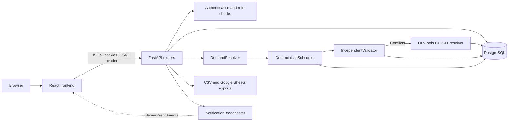
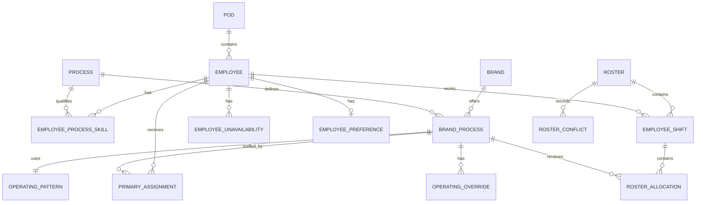
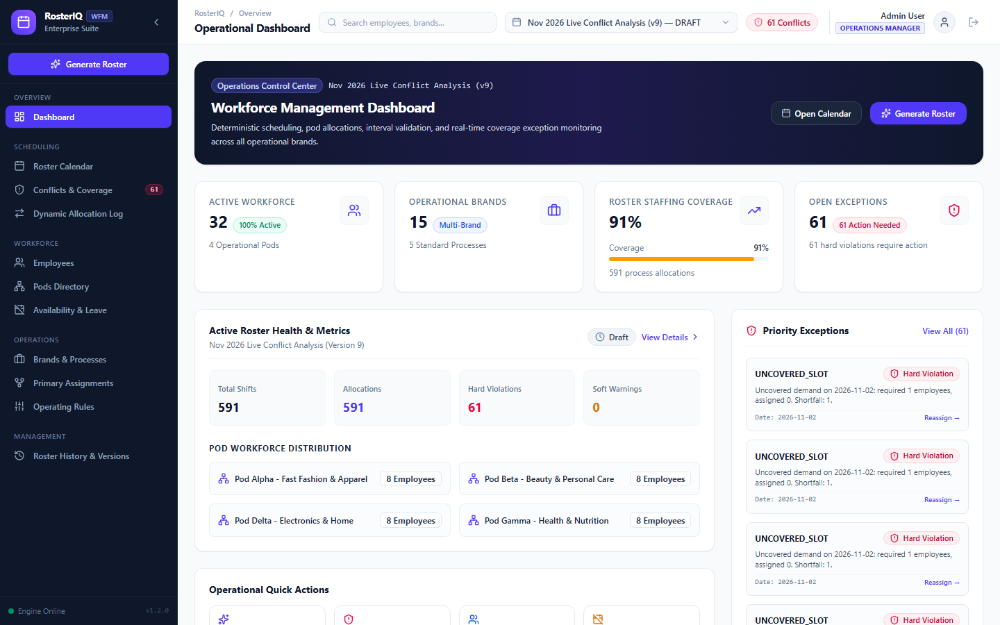

# RosterIQ

RosterIQ is a multi-brand workforce scheduling application that builds monthly rosters, records scheduling conflicts, and supports manager-reviewed reassignment.

[Live application](https://roster-iq-delta.vercel.app) · [API documentation](https://rosteriq-backend-km04.onrender.com/docs) · [GitHub repository](https://github.com/midatbest-core/RosterIQ)

> These deployment URLs are configured in the repository, but availability could not be independently confirmed during the documentation audit on 13 November 2026.

## Problem

Operations teams may support several brands, each with different processes, hours, holidays, and minimum staffing. Employees have different skills, pods, shifts, weekly-off preferences, and approved leave. A valid roster must cover demand without assigning an unqualified or unavailable employee, exceeding capacity, or overlapping work.

RosterIQ is intended for operations managers, pod leads, brand users, and employees. For example, one employee may support Brand A customer service from 09:00–13:00 and Brand B order processing from 14:00–18:00. Those allocations can share one shift; overlapping intervals, approved leave, missing skills, or excess capacity make an assignment invalid.

| Concept | Meaning in RosterIQ |
|---|---|
| Availability | Active employee with no approved `EmployeeUnavailability` on the date |
| Skill eligibility | Active `EmployeeProcessSkill` matches the `BrandProcess` process |
| Operating hours | `OperatingPattern`, optionally changed by `OperatingOverride` |
| Required staffing | Weekday/weekend/holiday/override headcount resolved into `DemandSlot` |
| Employee assignment | Effective-dated `PrimaryAssignment` to a `BrandProcess` |
| Pod restriction | Same-pod backups may be automatic; cross-pod work requires manager-controlled resolution |

## Implemented capabilities

| Module | What it does | Limitation |
|---|---|---|
| Workforce | Employees, pods, skills, capacity, preferences, and unavailability | New employees need skills/assignments before normal allocation |
| Brands and processes | Brands, processes, mappings, operating rules, and assignments | No new-brand approval workflow |
| Roster generation | Persists monthly shifts and allocations from a deterministic greedy scheduler | Synchronous API operation |
| Conflict detection | Detects coverage, overlap, leave, skill, capacity, shift-bound, and cross-pod violations | See conflict-enum limitation below |
| Conflict resolution | OR-Tools CP-SAT preview/apply workflow | Manager-triggered; not part of every generation call |
| Leave/change requests | Impact preview, manager approval/rejection, roster follow-up | Existing-record changes, not brand/employee onboarding |
| Lifecycle | `DRAFT`, `VALIDATED`, `PUBLISHED`, `STALE`, and child versions | Hash does not include every scheduling input |
| Access control | Admin, Operations Manager, Pod Lead, Brand User, Employee | No tenant/organisation model or database RLS |
| Export | Scoped CSV and optional Google Sheets | Google configuration required |
| Notifications | Persistent records, optional email, process-local SSE | Process-local broadcaster |

## Technology stack

| Technology | Use | Project-specific reason |
|---|---|---|
| React 19, TypeScript | `frontend/src` | Role-specific UI and typed API client |
| Vite 8, Tailwind CSS 4 | Frontend tooling | Static build and local proxy to FastAPI |
| FastAPI, Pydantic | HTTP API | Typed contracts, validation, OpenAPI |
| SQLAlchemy 2, PostgreSQL 16 | Persistence | Relationships, transactions, constraints |
| Alembic | `backend/alembic` | Versioned schema migrations |
| OR-Tools CP-SAT | Conflict resolver | Constraint search for reviewed resolutions |
| PyJWT, bcrypt | Authentication | Signed cookie token and password hashing |
| Pytest | Backend tests | API, model, scheduler, permissions, exports, lifecycle |
| Vercel, Render | Deployment configuration | Static frontend and one-worker ASGI backend |

Python 3.12+ is declared. No Node engine is pinned; audit checks used Node 25.8.1/npm 11.11.0.

## 5. System Architecture



### End-to-End Data Flow

1. **Demand generation:** `DemandResolver` evaluates each brand-process `OperatingPattern`, checks date-specific overrides, applies public-holiday behavior (`CLOSED`, `NORMAL`, or `REDUCED`), and emits the required `DemandSlot` objects.
2. **Deterministic allocation:** `DeterministicScheduler` evaluates effective `PrimaryAssignment` mappings, respects weekly-off preferences and approved leave, and assigns eligible staff within their standard shift windows and daily capacity.
3. **Independent validation:** `IndependentValidator` recomputes demand and evaluates each generated shift against strict operational rules without consulting the scheduler's internal decisions.
4. **Constraint-based conflict resolution:** Detected conflicts can be passed through the manager-triggered OR-Tools CP-SAT preview/apply workflow, which evaluates replacement candidates with lexicographic optimization. Cross-pod application remains under Operations Manager or Admin control.
5. **Event notification:** Roster generation, publication, and request resolution create notifications. `NotificationBroadcaster` multicasts process-local events to connected clients through Server-Sent Events (SSE).
6. **Persistence and publication:** Generation stores `Roster`, `EmployeeShift`, `RosterAllocation`, and `RosterConflict` records. Publication rejects stale configuration or unresolved hard conflicts.

| Area | Important implementation |
|---|---|
| API registration | `backend/app/main.py` |
| Authentication/roles | `backend/app/modules/auth/dependencies.py` |
| Workforce | `backend/app/modules/workforce/router.py`, `models.py` |
| Operations | `backend/app/modules/operations/router.py`, `models.py`, `pattern_models.py` |
| Demand/eligibility | `backend/app/modules/roster/engine/demand.py`, `eligibility.py` |
| Scheduler/validator | `engine/scheduler.py`, `engine/validator.py` |
| CP-SAT resolver | `engine/resolver.py` |
| Lifecycle/API | `backend/app/modules/roster/router.py` |

## 6. Database Design and Data Modelling

`PrimaryAssignment` is the implemented employee-brand assignment: it links an employee to a specific `BrandProcess`, not directly to a brand.

The relational schema is normalized around explicit entities and join tables, with foreign keys, unique constraints, and targeted indexes protecting operational consistency.



### Relational Modelling Highlights

- **Single-resource and multi-resource representation:** Both use the same `PrimaryAssignment` abstraction. A single-resource brand-process has one effective primary assignment; a multi-resource brand-process has multiple priority-ordered assignments.
- **Single-shift invariant:** The database enforces `uq_roster_employee_date_shift` across `(roster_id, employee_id, date)` in `employee_shifts`, so an employee has at most one enclosing shift per roster day.
- **Dynamic shift slicing:** `RosterAllocation.shift_id` links allocations to an `EmployeeShift`. An employee working across two brands on the same day therefore has one shift containing multiple non-overlapping allocations.
- **Skill and availability modelling:** `EmployeeProcessSkill` records process eligibility, while `EmployeeUnavailability` and `EmployeePreference` record approved absence and weekly-off preferences separately.
- **Indexed lookup paths:** Migrations index shift roster/employee/date columns, allocation shift/brand-process/date columns, and employee-unavailability employee/date columns to support the scheduler's common access paths.
- **Version integrity:** `Roster` versions are unique per month, year, and version. Published versions are treated as immutable; subsequent changes use child drafts.

An employee supports multiple processes through `EmployeeProcessSkill` and multiple brands through assignments to different `BrandProcess` records. `BrandProcess` allows a shared process definition to carry brand-specific operating rules.

## Scheduling algorithm

A greedy algorithm makes a deterministic best available choice at each step instead of exploring all complete schedules.

### Initial generation

1. Resolve each active brand-process/date using override → weekday rule → holiday behavior precedence.
2. Sort operating demand by start time, brand, and process.
3. Consider effective primary assignments in priority order.
4. Require active status, process skill, no approved leave, containing shift window, no overlap, and remaining daily capacity.
5. If needed, rank qualified same-pod backups by weekly-off preference and name.
6. Record cross-pod employees as candidates; do not auto-allocate them.
7. Record remaining shortages as `UNCOVERED_SLOT` hard violations.
8. Enclose an employee's daily allocations in at most one shift.

### Conflict resolution

CP-SAT uses Boolean/integer decisions to explore combinations. Resolver stages maximize covered staff positions, maximize fully satisfied intervals, minimize cross-pod work, minimize baseline changes, then prefer primaries while penalizing preferred-weekly-off work. It attempts same-pod resolution first and may run a cross-pod pass. Applying cross-pod changes requires Operations Manager/Admin authorization.

Hard constraints include skills, approved availability, shift bounds, non-overlap, capacity, and complete interval coverage. Weekly-off preference, primary retention, cross-pod minimization, and baseline stability are optimization preferences. If no feasible employee exists, demand remains uncovered; coverage is not guaranteed.

### Example

| Employee | Pod | Skills | State |
|---|---|---|---|
| Asha | Alpha | Brand A support, Brand B orders | Available |
| Ben | Alpha | Brand A support | Approved leave |
| Chen | Beta | Brand A support | Available |

If Brand A needs 09:00–13:00 support and Brand B needs 14:00–18:00 orders, Asha can cover both within one eight-hour shift. Ben is ineligible. If Asha becomes unavailable, Chen is a cross-pod candidate, but initial generation leaves Brand A uncovered until manager review.

## Independent validation

Separate validation reduces the chance that allocator defects silently approve their own output.

| Rule | Meaning | Effect |
|---|---|---|
| `INVALID_SHIFT` | Invalid/overnight interval or multiple shifts per employee/date | Hard; blocks publication |
| `SKILL_MISMATCH` | Missing process skill | Hard; blocks |
| `UNAVAILABLE_ALLOCATION` | Work during approved leave | Hard; blocks |
| `CROSS_POD_UNAPPROVED` | Cross-pod work lacks approval | Hard; blocks |
| `SHIFT_BOUND_EXCEEDED` | Allocation has no containing shift | Hard; blocks |
| `DAILY_CAPACITY_EXCEEDED` | Minutes exceed capacity | Hard; blocks |
| `DOUBLE_BOOKING` | Employee allocations overlap | Hard; blocks |
| `PARTIAL_COVERAGE` | Allocation covers only part of required interval | Hard; blocks |
| `UNCOVERED_SLOT` | Full-interval headcount is below demand | Hard; blocks |

The validator currently emits only hard violations. `SOFT_WARNING` exists in types but is not emitted.

## Original DataStraw assignment questions

### Q1. How would you model employees, brands, processes, pods and their relationships?

Use explicit relational joins. Employees optionally belong to pods; `EmployeeProcessSkill` joins employees to processes; `BrandProcess` joins brands to processes; effective-dated `PrimaryAssignment` joins employees to brand-processes. This supports employees across brands/processes without duplication. Foreign keys and unique constraints protect relationships. Tenant/organisation ownership is not modeled.

### Q2. How would you generate a monthly roster and determine the scheduling constraints?

Create demand from operating days/hours, staffing minimums, holidays, and overrides. Try effective primaries and same-pod backups after checking active status, skill, leave, shift containment, overlap, and capacity. Weekly offs affect ranking rather than absolute availability. Validate independently; persist `DRAFT` with hard violations or `VALIDATED` otherwise.

### Q3. How would you handle brands that have only one dedicated employee versus brands that have multiple employees?

Use the same assignment model. One assignment creates a single-resource risk; multiple priority-ordered assignments provide alternatives. Both search qualified same-pod backups, expose cross-pod candidates, and retain uncovered demand when headcount cannot be met.

### Q4. What happens if the only employee assigned to a brand is unavailable on a required working day?

The primary fails eligibility. The scheduler searches skilled, available, non-overlapping, capacity-safe employees in the primary pod. Other-pod employees are candidates only. With no same-pod replacement it records `UNCOVERED_SLOT`; a manager may preview/apply resolver output or intervene manually before publication.

### Q5. How would you handle conflicting requirements or insufficient staffing?

Treat skills, leave, overlap, capacity, shift bounds, coverage, and unapproved cross-pod work as hard constraints. Treat weekly-off preference, primary retention, cross-pod use, and schedule churn as optimization goals. Validation blocks publication. CP-SAT may return optimal, feasible, infeasible, or residual shortage results; shortages remain visible.

### Q6. Which parts of the roster process should be automated and which should remain under human control? Why?

Automate demand, eligibility, primary/same-pod allocation, validation, impact preview, and recommendations. Keep publication, resolver application, cross-pod approval, leave/plan-change approval, and exceptional reassignment under Operations Manager/Admin control because they change commitments or boundaries. RosterIQ follows this split, though some master-data mutations do not yet mark rosters stale.

### Q7. What would you change if the number of employees and brands doubled?

Synchronous generation and repeated scans are the first risks: the stored synthetic run increased from 28.9 ms at 36 employees to 27.3 s at 300. Proposed work: background jobs/progress, query batching, candidate indexes by process/pod/date, profiling-driven DB indexes, solver decomposition, caching immutable monthly inputs, and production metrics. These are not currently implemented.

### Q8. If you had one additional week to improve the system, what would you prioritise first?

Prioritize correctness of change tracking. Include active employees, skills, rules, preferences, and assignments in the config hash; run stale detection for every scheduling mutation; align persisted/engine conflict enums; and add integration tests. Success means every relevant mutation invalidates affected unpublished rosters, published versions remain immutable, and regeneration stays validator-consistent.

## 11. Performance Benchmarks (Audited and Verified)

`docs/benchmarks` contains synthetic harnesses and archived JSON. These are historical single measurements—not averages or production latency. Scheduler calls exclude database, HTTP, TLS, and frontend time. The archived environment records Windows 11, AMD 8-core/16-thread 3.20 GHz, 15.31 GB RAM, and Python 3.14.3. Scripts/results were audited but not rerun because they write result files.

### 11.1 Deterministic Scheduling Engine Scaling (30-Day Grid)

| Dataset | Employees | Pods | Brand-Processes | Shifts | Allocations | Conflicts | Generation Time | Validation Time | Total Compute | Full Coverage? |
|:--|--:|--:|--:|--:|--:|--:|--:|--:|--:|:--|
| **Dataset A (Core Demo)** | 36 | 4 | 18 | 470 | 470 | **0** | **28.9 ms** | **4.1 ms** | **33.0 ms** | **Yes (100%)** |
| **Dataset B (Medium)** | 100 | 10 | 48 | 465 | 465 | **775** | **1,029.9 ms** | **8.0 ms** | **1,037.9 ms** | No (37.5%; shortage) |
| **Dataset C (Large)** | 300 | 20 | 120 | 1,853 | 1,853 | **1,237** | **27,275.3 ms** | **40.9 ms** | **27,316.3 ms** | No (shortage) |

Data is generated in memory for November 2026. Employees receive three skills, one primary assignment, a weekly-off preference, and every tenth employee receives one leave day. Each measurement is one run with no recorded warm-up or statistics. The raw `hard_conflicts`/`soft_conflicts` fields are invalid because the harness compares enum names to `HARD`/`SOFT`, not `HARD_VIOLATION`/`SOFT_WARNING`; `total_conflicts` is the usable count.

A valid archived single-slot CP-SAT run used 10 candidates, returned `OPTIMAL`, proposed one allocation, and took 48.5 ms. The 5/20/50-slot rows are excluded because duplicated decision keys invalidate them. API, DB, and SSE micro-benchmarks are omitted because they are not end-to-end deployed measurements.

## Local setup (PowerShell)

Prerequisites: Git, Python 3.12+, Node/npm supported by Vite 8, and PostgreSQL (Docker optional).

```powershell
# 1. Clone
git clone https://github.com/midatbest-core/RosterIQ.git
cd RosterIQ

# 2. Python environment
python -m venv .venv
.\.venv\Scripts\Activate.ps1
python -m pip install --upgrade pip

# 3. Runtime + test dependencies
pip install -e ".\backend[dev]"

# 4. Configuration
Copy-Item .env.example backend\.env

# 5. Optional local PostgreSQL
docker compose up -d postgres

# 6. Migrations (alembic.ini paths are relative to backend)
$env:PYTHONPATH = (Resolve-Path .\backend).Path
Push-Location backend
alembic upgrade head
Pop-Location

# 7. Optional demo seed
python -m app.scripts.seed_demo_data

# 8. Backend
uvicorn app.main:app --app-dir backend --reload --port 8000
```

In a second terminal:

```powershell
cd frontend
npm install
npm run dev
```

- Frontend: <http://localhost:5173>
- Health: <http://localhost:8000/health>
- Swagger: <http://localhost:8000/docs>

The Vite proxy forwards `/api` to port 8000. Hosted builds use `VITE_API_BASE_URL`.

### Environment variables

| Variable | Purpose |
|---|---|
| `ROSTERIQ_DATABASE_URL` | SQLAlchemy PostgreSQL URL |
| `ROSTERIQ_JWT_SECRET` | Replace with a long random secret |
| `ROSTERIQ_ACCESS_TOKEN_MINUTES` | Cookie lifetime, 5–1440 minutes |
| `ROSTERIQ_COOKIE_SECURE` | `false` locally; `true` for HTTPS |
| `ROSTERIQ_CORS_ORIGINS` | JSON array or comma-separated frontend origins |

Optional SMTP, Google Sheets, SameSite, and demo settings are in `backend/app/core/config.py`. The seed creates 36 employees, brands, pods, rules, requests, and users; it checks natural keys before most inserts and is intended to be rerunnable. It also uses known demo passwords, so run it only on an isolated development/demo database.

### Tests and build checks

```powershell
cd backend
python -m pytest

cd ..\frontend
npm run lint
npm run build
```

Latest audit (13 November 2026): **109 backend tests passed in 73.45 seconds**. Frontend lint exited 0 with existing warnings. The build command was verified from `package.json` but not run during this documentation-only audit because it writes `frontend/dist`.

| Problem | Check |
|---|---|
| DB connection | PostgreSQL health, port 5432, and `ROSTERIQ_DATABASE_URL` |
| Settings ignored | Use `backend/.env` or export `ROSTERIQ_*` before Python starts |
| Migration path error | Run Alembic from `backend` with absolute backend `PYTHONPATH` |
| Port occupied | Change Uvicorn port and Vite proxy/API base |
| Frontend/API failure | Health endpoint, proxy, CORS, cookies, `VITE_API_BASE_URL` |
| Install failure | Python 3.12+, upgraded pip, fresh venv, committed npm lockfile |

## Testing scope

Pytest uses isolated in-memory SQLite with foreign keys enabled. Tests cover auth/CSRF, role and pod isolation, CRUD/constraints, migrations, scheduling and validation, CP-SAT resolution, reassignment/version staleness, brand/employee request lifecycles, notifications/SSE/email, CSV, and mocked Google Sheets. Scenarios include cross-brand non-overlapping work, leave, same-pod backup, cross-pod authorization, partial coverage, immutable publication, and IDOR attempts. Tests demonstrate covered examples, not universal feasibility or production performance. No frontend unit/E2E suite is committed.

## Roles

| Role | Main scope |
|---|---|
| Admin | Global management and roster operations |
| Operations Manager | Master data, generation/publication, resolver, request review |
| Pod Lead | Pod-scoped employee/roster views and leave submission; no approval |
| Brand User | Own-brand schedule/export and plan-change requests |
| Employee | Own profile, published tasks/export, availability requests |

Authentication uses a signed JWT access cookie. Protected master-data mutations also require matching CSRF cookie/header values. Brand/employee/pod scope checks exist, but full multi-tenant isolation is not implemented.

## Limitations and next work

Current limitations:

- No tenant/organisation entity, tenant constraints, or database row-level security.
- Brand/employee creation is direct; no creation-request approval workflow.
- Synchronous generation/resolution.
- Config hash excludes inputs such as skills and employee status.
- Engine conflicts include `INVALID_SHIFT` and `DAILY_CAPACITY_EXCEEDED`, but the persisted enum does not; conversion can fail.
- Weekly offs are preferences; overnight shifts are rejected; fairness history is not implemented.
- Portal mutations do not consistently attach the CSRF dependency used by master-data routes.
- Process-local SSE is not suitable for multiple workers without a shared broker.
- Synthetic single-run benchmarks; no production DB/WAN measurement.
- Frontend lint warnings and no frontend test suite.

Priorities: fix conflict/hash correctness; add background jobs; add tenant ownership; add onboarding approval if required; add frontend tests; repair/repeat benchmarks; and use a shared notification broker with consistent CSRF enforcement.

## Demo and screenshots

UI captures are under `screenshots/` for dashboard, calendar scopes, conflicts, reassignment, workforce, operations, allocation log, and audit history. Seed locally for demo access. Public documentation intentionally omits seed passwords.



## Conclusion

RosterIQ demonstrates relational workforce modeling, constraint-aware scheduling, independent validation, CP-SAT-assisted resolution, role-scoped APIs, versioned publication, exports, and automated tests. Publication, cross-pod application, and request approval remain human-controlled. The limitations above distinguish current behavior from proposed work.
