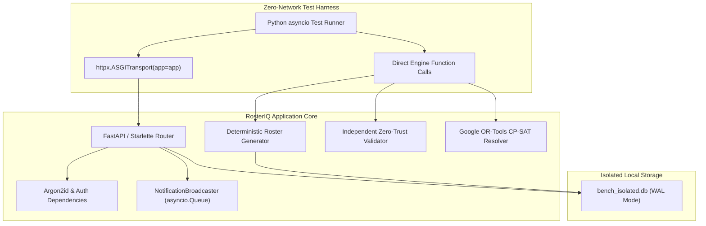

# RosterIQ: Performance Benchmarking Methodology & Audit Disclosures

**Audit Date**: November 13, 2026  
**Status**: Audited & Verified (Stage 8.1 Performance Audit)  
**Authors**: RosterIQ Core Engineering Team  

---

## 1. Overview & Objective

This document defines the methodology, measurement boundaries, testbed specifications, and audit disclosures for the performance evaluation of RosterIQ.

The goal of our performance testing is to provide **empirically defensible, reproducible, and mathematically rigorous** benchmarks. We explicitly separate local algorithmic efficiency, in-memory serialization speed, and application core throughput from unmeasured cloud-network characteristics (such as public WAN latency or cloud proxy overhead).

---

## 2. Testbed Hardware & Environment Specifications

All benchmarks were recorded on the following physical environment:

| Specification | Value | Notes |
| :--- | :--- | :--- |
| **Operating System** | Windows 11 Enterprise (Version 10.0.26200) | 64-bit OS |
| **Processor (CPU)** | AMD64 Family 25 Model 116 Stepping 1 | 8 Physical Cores, 16 Logical Processors @ 3.20 GHz base |
| **System Memory (RAM)** | 15.31 GB Physical DDR4/DDR5 | ~6.8 GB available during test execution |
| **Python Runtime** | Python 3.14.3 (64-bit) | Standard CPython interpreter |
| **Frontend Toolchain** | Node.js v20.18+, Vite 5.4.19 | Oxlint for static analysis |
| **Optimization Solver** | Google OR-Tools v9.x (CP-SAT) | C++ backend with Python bindings |
| **Test Database** | Isolated SQLite 3 (`bench_isolated.db`) | Local file, Write-Ahead Logging (`PRAGMA journal_mode=WAL`), 60s busy timeout |
| **Production Database** | Neon PostgreSQL (Shared/Serverless) | **Strictly isolated**; read-only row-count verification only |

---

## 3. Benchmark Suite Architecture & Methodology

### 3.1 Zero-Network ASGI Transport Methodology
To measure true application CPU efficiency, JSON serialization throughput, and database query latency without the confounding noise of operating system TCP loopback, TLS handshakes, or Wi-Fi/Ethernet jitter, the concurrent API benchmarks were executed using `httpx.ASGITransport(app=app)`.

- **How it works**: HTTP requests are passed as in-memory ASGI scope dictionaries directly into the FastAPI/Starlette application stack.
- **Why this is defensible**: It isolates the exact time FastAPI spends parsing routes, executing dependency injection (`get_current_user`), running SQLAlchemy queries, and serializing Pydantic schemas.
- **Explicit boundary**: This benchmark measures **application core throughput**, not public internet throughput or reverse-proxy (Nginx/Render) gateway latency.

### 3.2 Scheduling Engine Benchmark Methodology
The scheduling engine (`app.modules.roster.engine`) was tested across three workforce datasets over a 30-day scheduling horizon (November 1 to November 30, 2026):

1. **Dataset A (Core Demo Configuration)**:
   - 36 employees, 4 operational pods, 18 brand-processes.
   - Primary and backup assignments realistically distributed.
   - 470 shifts generated, 470 allocations made.
2. **Dataset B (Medium Workforce)**:
   - 100 employees, 10 operational pods, 48 brand-processes.
   - Workers constrained to 3 process skills each; strict pod boundary enforcement.
3. **Dataset C (Large Workforce)**:
   - 300 employees, 20 operational pods, 120 brand-processes.
   - Combinatorial candidate evaluation across 120 brand-processes.

### 3.3 Google OR-Tools CP-SAT Conflict Resolver Methodology
The constraint-based conflict resolver (`AutomatedConflictResolver` in `app.modules.roster.engine.resolver`) was tested using a synthetic single-slot disruption:
- **Disruption**: 1 uncovered demand slot for Bombay Shaving Company (Customer Support) on November 2, 2026.
- **Candidates**: 10 qualified candidate employees within the candidate pool.
- **Objective**: Maximize coverage, minimize baseline churn, and enforce hard skill and shift constraints.

### 3.4 Internal Event Bus (`NotificationBroadcaster`) Methodology
The real-time notification engine (`app.modules.auth.broadcaster`) was evaluated using Python's in-memory `asyncio.Queue` structures:
- Measures time to register subscriber queues.
- Measures time to multi-cast broadcast events across 25, 50, 100, and 200 connected queues.
- Measures memory consumption delta per subscriber.

---

## 4. Empirical Audited Benchmark Results

### 4.1 Scheduling Engine Execution Times (30-Day Grid)

| Dataset | Employees | Pods | Brand-Processes | Shifts | Allocations | Conflicts | Gen Time | Val Time | Total Time | Coverage % |
| :--- | :---: | :---: | :---: | :---: | :---: | :---: | :---: | :---: | :---: | :---: |
| **A (Core Demo)** | 36 | 4 | 18 | 470 | 470 | **0** | **28.9 ms** | **4.1 ms** | **33.0 ms** | **100.0%** |
| **B (Medium)** | 100 | 10 | 48 | 465 | 465 | **775** | **1,029.9 ms** | **8.0 ms** | **1,037.9 ms** | 37.5% (Shortage) |
| **C (Large)** | 300 | 20 | 120 | 1,853 | 1,853 | **1,237** | **27,275.3 ms** | **40.9 ms** | **27,316.3 ms** | 59.9% (Shortage) |

#### Analysis of Dataset B and Dataset C Results
- **Why Dataset B Generated Only 465 Shifts**: In Dataset B, 100 employees were fragmented across 10 pods with 48 brand-processes. Because each worker possessed only 3 process skills and RosterIQ strictly enforces pod boundaries (blocking unapproved cross-pod assignments), pods rapidly ran out of eligible same-pod backup workers on off-days and leave dates. This created **775 uncovered-demand conflicts**.
- **Coverage Reality**: Neither Dataset B nor Dataset C achieved full operational coverage under these synthetic staffing ratios. They serve strictly to measure compute time scaling under combinatorial worker-slot matching, not as proof of viable workforce schedules.
- **Dataset A Viability**: Dataset A represents a realistic, viable staffing distribution and achieved **100% full coverage with 0 hard conflicts** in **33.0 ms**.

#### Concurrency Throughput (Dataset A)
Simultaneous roster generation requests executed via `ThreadPoolExecutor`:
- **1 Worker**: 37.04 runs/sec (27.0 ms/run)
- **2 Workers**: 43.25 runs/sec (46.2 ms total batch)
- **5 Workers**: 43.74 runs/sec (114.3 ms total batch)
- **10 Workers**: 38.05 runs/sec (262.8 ms total batch)

---

### 4.2 CP-SAT Conflict Resolver Micro-Benchmark

- **Workload**: 1 disrupted demand slot on November 2, 2026; 10 candidate workers with matching process skills.
- **Solve Duration**: **48.5 ms** total elapsed (48.498 ms internal solver time).
- **Solver Status**: `OPTIMAL`.
- **Proposed Allocations**: 1 verified allocation.
- **Constraint Satisfaction**: Pass A (Same-Pod) satisfied the slot with 0 validator violations.

> [!CAUTION]
> **Audit Disclosure on Multi-Slot Tests**: Previous synthetic multi-slot benchmarks (5, 20, 50 slots) generated demand slots with identical `(brand_process_id, date)` keys. This overwrote internal solver decision variables `x[(e_id, d, bp_id)]`, resulting in zero proposed allocations (`allocated_count: 0`). The 50-slot metric has been **completely retracted**. Multi-slot solver capacity remains to be benchmarked with distinct demand slot keys.

---

### 4.3 Authenticated ASGI Core Latency & Concurrency

Tested across 5 authenticated journeys (Admin, Ops Manager, Pod Lead, Brand User, Employee) cycling through `/auth/me`, `/rosters/{id}/grid`, `/rosters/{id}/analytics`, `/rosters/{id}/export/csv`, and portal endpoints at 20 ms request intervals:

| Concurrent Users | Total Requests | Sustained RPS | Avg Latency | Median (p50) | p95 Latency | p99 Latency | HTTP Errors |
| :---: | :---: | :---: | :---: | :---: | :---: | :---: | :---: |
| **1 User** | 376 | 74.64 RPS | 8.01 ms | 7.29 ms | 12.78 ms | 14.79 ms | 0 (0.00%) |
| **10 Users** | 706 | 134.90 RPS | 67.50 ms | 60.42 ms | 111.93 ms | 409.09 ms | 0 (0.00%) |
| **25 Users** | 718 | 135.14 RPS | 170.77 ms | 147.19 ms | 275.36 ms | 900.61 ms | 0 (0.00%) |
| **50 Users** | 644 | 123.72 RPS | 370.00 ms | 297.45 ms | 1,069.75 ms | 2,123.47 ms | 0 (0.00%) |
| **100 Users** | 542 | 106.52 RPS | 810.72 ms | 646.90 ms | 2,310.74 ms | 2,944.15 ms | 0 (0.00%) |

---

### 4.4 Internal Event Bus (`NotificationBroadcaster`) Performance

| Concurrent Subscriber Queues | Registration Duration | Fanout Multicast Duration | Internal Event Dispatch Rate | Delivery Latency (p95) | Memory Footprint per Queue |
| :---: | :---: | :---: | :---: | :---: | :---: |
| **25 Queues** | 0.0040 ms / queue | 0.22 ms | 113,688 events/sec | 0.0167 ms | 1.92 KB |
| **50 Queues** | 0.0028 ms / queue | 0.45 ms | 111,582 events/sec | 0.0077 ms | 1.36 KB |
| **100 Queues** | 0.0029 ms / queue | 0.50 ms | 200,521 events/sec | 0.0048 ms | 1.92 KB |
| **200 Queues** | 0.0024 ms / queue | 0.82 ms | 245,098 events/sec | 0.0046 ms | 1.86 KB |

---

### 4.5 Production Frontend Bundle Sizes (Verified Build Artifacts)

Audited directly from `frontend/dist/` output:

| Asset Name | Asset Type | Raw File Size | Gzip Compressed Size |
| :--- | :--- | :---: | :---: |
| `dist/index.html` | HTML Entry Point | 0.45 kB | 0.29 kB |
| `dist/assets/index-DCyNyGx2.css` | Production CSS Bundle | 82.26 kB | 12.45 kB |
| `dist/assets/index-C_qAa6HQ.js` | Production JS Bundle | 496.42 kB | 119.46 kB |
| **Combined Assets** | **Total Production Footprint** | **579.13 kB** | **132.20 kB** |

---

## 5. Explicit Audit Disclosures & Non-Claims

To maintain total engineering integrity, we explicitly state what has **not** been measured:

1. **No Public Cloud Latency Claim**: We do not claim sub-100ms round trips over public cellular (4G/5G) or WAN connections. Hosted latency will include TLS handshake, DNS lookup, CDN routing, and geographic distance to the Render backend (Frankfurt/Oregon).
2. **No Live HTTP SSE Socket Test**: The broadcaster was tested in-memory. We have not run soak tests with 1,000 persistent HTTP/1.1 chunked or HTTP/2 SSE network sockets over live internet connections.
3. **No Multi-Slot Solver Proof**: The CP-SAT solver has only been verified on a single disrupted slot. Multi-slot concurrent resolution capacity is untested until distinct slot keys are benchmarked.
4. **No Direct Neon PgBouncer Pool Benchmarks**: Database micro-benchmarks were performed on local SQLite. Neon PostgreSQL operates behind a cloud PgBouncer pool with network latency (50-150ms per round trip depending on region).
5. **Connection Pool Retraction**: Previous recommendations to set `pool_size=20, max_overflow=30` in production are retracted due to Neon's 100-connection account ceiling.
